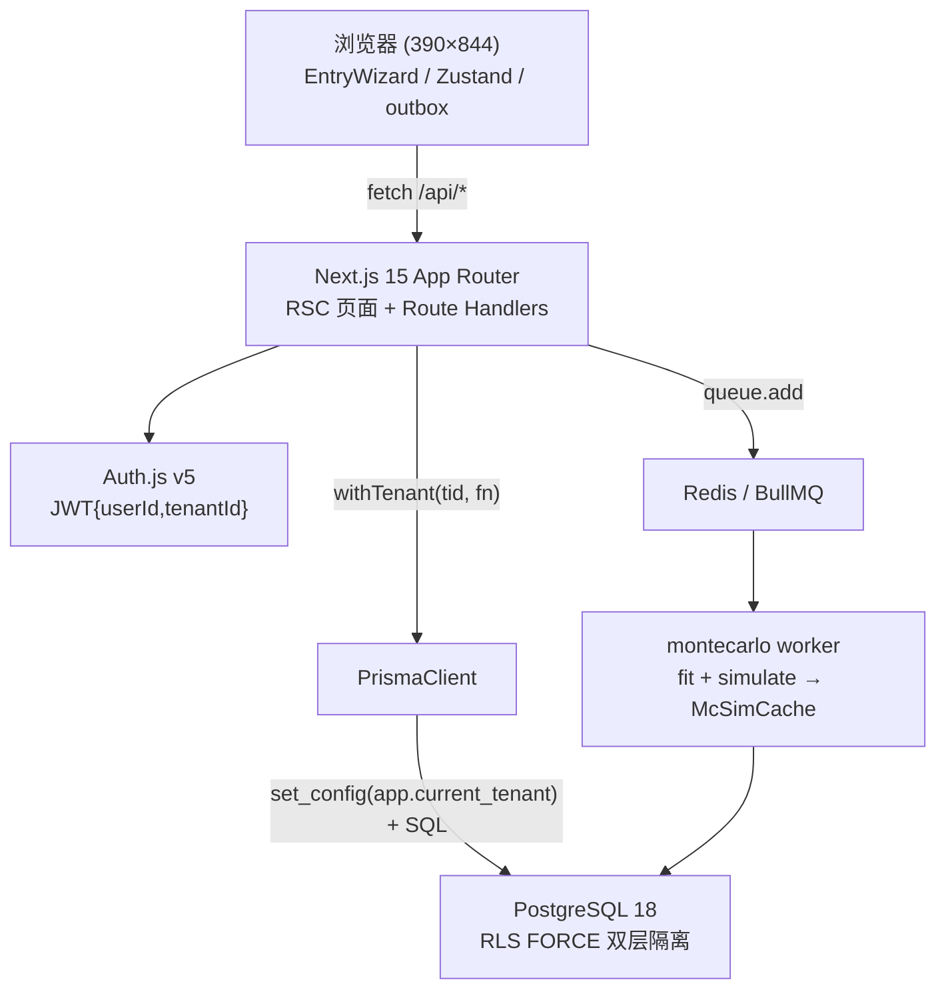

# Design — 幻想兔弹珠机预测系统

## 架构总览



## 关键契约

### withTenant（唯一数据入口）

```ts
export async function withTenant<T>(tenantId: string, fn: (tx: PrismaTransaction) => Promise<T>): Promise<T> {
  return prisma.$transaction(async (tx) => {
    await tx.$executeRaw`SELECT set_config('app.current_tenant', ${tenantId}, true)`;
    return fn(tx);
  });
}
```

- `true` = 事务本地：PgBouncer transaction 模式下连接复用不串租户。
- repo 层所有函数签名 `(tx: PrismaTransaction, ...)`，不存在裸 tenantId 查询路径。
- 本机开发无 PgBouncer 时语义等价（连接直连 PG18）。

### 录入事务（POST /api/rounds）

1. `RoundInputSchema.safeParse` 失败 → 400。
2. `withTenant` 内 `findUnique(tenantId_sessionId_clientRequestId)` 命中 → 返回既有记录（幂等）。
3. 新记录：`computeReward/computeCards/isHit` 派生 → `round.create` → `session.update` 冗余统计 → `updatePosterior` → `updateBanditArm`（同一 `$transaction`）。
4. 事务提交后（M4）若样本跨 30/50/100 阈值 → `queue.add` 触发重拟合，不阻塞响应。

### RLS 策略（迁移 SQL 末尾手写追加）

对 Machine/Session/Round/Posterior/SimParams/BanditArm/McSimCache/AuditLog：

```sql
ALTER TABLE <t> ENABLE ROW LEVEL SECURITY;
ALTER TABLE <t> FORCE ROW LEVEL SECURITY;
CREATE POLICY tenant_isolation ON <t>
  USING (tenant_id = current_setting('app.current_tenant')::uuid)
  WITH CHECK (tenant_id = current_setting('app.current_tenant')::uuid);
```

GlobalPrior/Membership/Tenant/User/OtpCode 无 tenant_id，不加 RLS（注释说明）。角色 `pinball_app` 无 BYPASSRLS。

### 算法栈接口

| 层 | 文件 | 契约 |
|---|---|---|
| L1 | `lib/predict/posterior.ts` | `update/revert(tx,machineId,power,hole)`；`estimate(counts,litHoles?)`；`dirichletMean` |
| L3 | `lib/predict/bandit.ts` | `recommend(tx,machineId,litHoles)`→`{thompsonPower,argmaxPower,bestArmProb[3],degraded,expectedReturn,channelProb[12]}`；K=2000、seed=machineId+litHoles 哈希可复现 |
| L2 | `lib/predict/montecarlo.ts` | `simulate(params,N=10000,seed)`→`{dist[12],stderr[12]}`；`fit(landHoles,powers)` 网格搜索最小化 KL |
| L4 | `lib/predict/pooling.ts` | `aggregateGlobalPrior()`；`priorForMachine(power,sampleN)`；α0=15×P̄，权重 n/(n+15) |
| 评估 | `lib/predict/evaluate.ts` | calibration / backtest / regretCurve / chiSquare / logLikelihoodRolling |

## 环境适配（本机）

- PostgreSQL 18.1（Postgres.app，已装）替代 docker postgres:16；建库 `pinball_dev` / `pinball_test`。
- Redis 7（homebrew，已运行）替代 docker redis。
- Docker 不可用：`docker-compose.yml`/`Dockerfile` 按 PLAN 编写为交付物，本地不起容器验证；worker 以 `pnpm worker` 本地进程方式验证。
- `.env`：`DATABASE_URL`/`DIRECT_DATABASE_URL` 均指向本机 PG18（无 PgBouncer）；`EMAIL_MODE=console`；OAuth 凭据留空（provider 不启用，代码就位）。

## 偏差记录（PLAN vs PRD/TECH-PLAN）

1. PLAN M1.1 依赖 `@aws-sdk/client-ses` 与 M1.4 的 Resend/nodemailer 双轨：TECH-PLAN 未指定 SDK。取 PLAN M1.4 优先级（Resend → nodemailer → console），不引 `@aws-sdk/client-ses`（减少未使用依赖）。
2. PLAN 说 `pnpm prisma migrate dev`：本机开发同样使用 dev 迁移；验收时对测试库 `migrate deploy`。
3. PLAN 验收命令含 `ppm test`（笔误）：按 `pnpm test` 执行。
4. PG 版本 18 替代 16：RLS/`set_config`/`timestamptz` 语义不变，无兼容风险。
5. `holeNumbering` 默认 `ltr`；PRD §1.1 洞口数 12（纠正 note-tips 的 10）。

## 风险控制

- 连接池串租户：事务本地 `set_config(...,true)` + 集成测试双租户交叉验证。
- 蒙特卡洛误导：χ² 失拟 p<0.01 → UI「以实测为准」。
- Thompson 短期探索劣档：degraded 提示 + argmax 对照。
