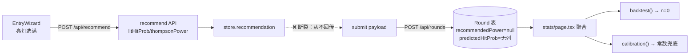

# 技术设计 — 统计页落点热力图与预测链路修复

## 边界

**在范围内**：`stats/page.tsx` 聚合、`StatsCharts.tsx` 展示、`EntryWizard.submit` payload、Prisma 迁移（+1 列）、`evaluate.ts` 聚合函数、`rounds/route.ts` 透传。

**不在范围内**：算法语义变更（calibration/backtest/regretCurve 只补输入不改公式）、推荐 API 逻辑、历史数据回填（不可得——历史局录入时未产生预测值，接受 n 从 0 增长）。

## 数据流现状与修复点



修复：`C → D` 补两字段；`E` 加列；`F` 加 landHoleByPower 聚合。

## 详细设计

### D1 热力图数据聚合（`evaluate.ts`）

```ts
/** 发力 × 洞位落点计数矩阵（索引序同 POWER_LEVELS × [1..holeCount]） */
export function landHoleByPower(
  rounds: RoundLike[],
  holeCount: number,
): { power: PowerLevel; total: number; holes: number[] }[]
```

- 与 `powerMultiplierMatrix` 同构：固定顺序遍历 `POWER_LEVELS`，缺失补 0（前端渲染「—」而非 undefined）。
- 返回每档 `total`（用于算行内占比与 χ² 期望）。

**为何放 `evaluate.ts`**：该文件是统计纯函数单一来源（`lib/predict/evaluate.ts` 头注释即此定位），`powerMultiplierMatrix` 已在此；stats page 只做数据装配。

### D2 热力图组件（`StatsCharts.tsx` 内，或拆 `components/stats/LandHeatmap.tsx`）

- CSS Grid：4 列 × 3 行（首列表头 = 发力档 + 总局数列），12 数据列。
- 单元格 = `<div>` + `background: color-mix(in srgb, var(--accent) X%, var(--surface))`，X 由「本格计数 / 该档最大计数」映射（0-90%）。
- 单元格内文字：计数 ≥1 显示数字，0 显示「·」（ muted ）。
- 容器 `overflow-x-auto`；单元格 `min-w-7`（28px）保证 12 列 × 28 = 336px 在 390px 视口可横向滚动。
- 洞位号列头 1-12；`text-[10px]`。
- χ² 与均匀期望说明保留在图下方（现有 `<p>` 结构不变）。
- 合规提示：区块底部加 `<p className="text-[10px] text-[var(--muted)]">`「历史统计不构成未来保证」（R1 要求）。

**为何不用 Recharts**：矩阵热力图本质是表格着色，Recharts 无原生热力图且需自定义 `Cell` 拼 shape，收益低于纯 CSS Grid（与既有矩阵表格风格一致）。

### D3 录入回传（`EntryWizard.tsx`）

```ts
const rec = store.recommendation;
const payload = {
  ...,
  recommendedPower: rec?.thompsonPower ?? null,
  recommendMode: rec?.degraded ? 'prior' : rec ? 'thompson' : null,
  predictedHitProb: rec?.litHitProb ?? null,
};
```

- `store.recommendation` 在亮灯选满时由 effect 预取；未取到（请求失败/未选满）→ 全部 null，与现状一致（不阻塞录入）。
- `recommendMode` 语义：`degraded=true` → `'prior'`（样本不足降级），否则 `'thompson'`。与 recommend API 的 `mode` 字段一致。
- outbox 路径无需改：payload 构造后统一走同一提交函数。

**schema 改动**：`RoundFieldsSchema` 加 `predictedHitProb: z.number().min(0).max(1).optional().nullable()`；`RoundPatchSchema` 自动继承 partial。

### D4 迁移

新迁移 `prisma/migrations/<ts>_round_predicted_hit_prob/migration.sql`：

```sql
ALTER TABLE "Round" ADD COLUMN "predictedHitProb" DOUBLE PRECISION;
```

`recommendedPower`/`recommendMode` 列已存在，无需迁移。RLS 不受影响（新列无策略变更需求）。

### D5 repo 透传

`repo.createRound` 的 data 增加 `predictedHitProb`（Prisma 类型自动带出）；`rounds/route.ts` 的 `repo.createRound` 调用处补 `predictedHitProb: input.predictedHitProb ?? null`。

### D6 stats page 聚合

- `select` 加 `predictedHitProb: true`；`typed` 映射补该字段（`RoundLike.predictedHitProb` 已定义）。
- `data.landHoleByPower` = `landHoleByPower(typed, 12)`。
- `landDist` 保留（χ² 仍用，或改为由矩阵聚合推导——保留现状最小改动）。

## 权衡与取舍

| 决策 | 备选 | 理由 |
| --- | --- | --- |
| 预测值取 `litHitProb` | 服务端重算/存 posterior 快照 | litHitProb 是录入时点真实推荐输出；重算会因后续数据变化而偏离「当时预测」，校准就失去意义 |
| 热力图纯 CSS Grid | Recharts 自定义 / heatmap 库 | 无新依赖、与既有矩阵表格视觉一致、移动端横向滚动可控 |
| 历史数据不回填 | 迁移脚本按 posterior 反推 | 反推值不是「当时预测」，会污染校准语义；宁可让 n 从 0 增长，文案如实说明 |
| `recommendMode` 一并补 | 只补 recommendedPower | 字段已存在且回测说明/审计需要区分 thompson/prior 期；同一处改动顺带接通成本近零 |

## 兼容性

- 旧 round：`recommendedPower`/`recommendedHitProb` 为 null → `backtest` 的 `if (!rec) continue` 与 `calibration` 的 `?? globalRate` 兜底自然生效，**无需改算法**。
- 编辑 round（PATCH）路径已透传 `recommendedPower`（`rounds/[id]/route.ts:70` 保留旧值）；补 `predictedHitProb` 的 partial 继承即可，无需单独改路由逻辑。
- 迁移为纯加列，向后兼容；`prisma migrate deploy` 幂等。
