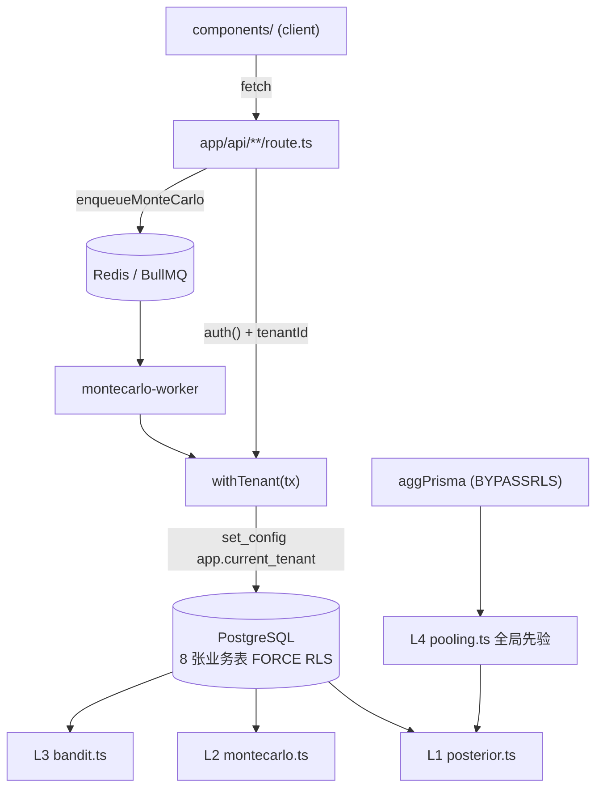

<!-- TRELLIS:START -->
# Trellis Instructions

These instructions are for AI assistants working in this project.

This project is managed by Trellis. The working knowledge you need lives under `.trellis/`:

- `.trellis/workflow.md` — development phases, when to create tasks, skill routing
- `.trellis/spec/` — package- and layer-scoped coding guidelines (read before writing code in a given layer)
- `.trellis/workspace/` — per-developer journals and session traces
- `.trellis/tasks/` — active and archived tasks (PRDs, research, jsonl context)

If a Trellis command is available on your platform (e.g. `/trellis:finish-work`, `/trellis:continue`), prefer it over manual steps. Not every platform exposes every command.

If you're using Codex or another agent-capable tool, additional project-scoped helpers may live in:
- `.agents/skills/` — reusable Trellis skills
- `.codex/agents/` — optional custom subagents

Managed by Trellis. Edits outside this block are preserved; edits inside may be overwritten by a future `trellis update`.

<!-- TRELLIS:END -->

# Repository Guidelines

面向 AI 编码助手的项目指南。人类向快速开始、环境变量、部署排障见 `pinball/README.md`；产品与技术权威文档见 `docs/spec/`；开发流程见 `.trellis/workflow.md`。本文只写代码助手必须知道、而上述文档没有或容易踩坑的部分。

## Project Overview

幻想兔弹珠机预测系统：**个人记录与统计分析工具**（合规红线见末节）。核心能力：录入每局弹珠机数据（倍率 / 亮灯 / 得分）→ Dirichlet 后验 + Thompson 采样推荐发力档位 → 高尔顿板蒙特卡洛模拟落点分布。

技术栈：Next.js 15.5（App Router）+ React 19 + TypeScript（strict）+ Prisma 6 / PostgreSQL + NextAuth v5（JWT）+ BullMQ / ioredis + zustand + zod v4 + Tailwind v4 + Vitest + Playwright。

**单仓单包**：全部应用代码在 `pinball/` 子目录，根目录只放 `docs/`、`.trellis/` 与本文件。下文路径如 `lib/rules.ts` 均指 `pinball/lib/rules.ts`。

## Architecture & Data Flow

四层预测算法栈（L1 posterior / L2 montecarlo / L3 bandit / L4 pooling）+ RLS 双层租户隔离：

关键数据流约定：

1. **一切业务表读写必须过 `withTenant(tenantId, fn)`**（`lib/db/tenant.ts`）——事务内先 `set_config('app.current_tenant', …, true)`（事务本地，兼容 PgBouncer），DB 侧 8 张业务表 `ENABLE + FORCE ROW LEVEL SECURITY` 双保险。**测试断言也不例外**，裸连接查业务表会因 `current_setting` 空串报 uuid 解析错误。
2. repo 层（`lib/db/repo.ts`）函数第一参一律 `tx: PrismaTransaction`，不接裸 `tenantId` 查询。
3. `aggPrisma`（BYPASSRLS 角色，`lib/db/agg-client.ts`）仅供 L4 跨租户匿名聚合，**严禁任何请求路径使用**；调用须在事务外。
4. RLS 只护单行不护外键：`createSession` / `createRound` 前手动 `findFirst({ where: { id, tenantId } })` 校验归属，失败抛错误码。
5. 冗余统计（`Session.roundCount/totalBet/totalWin/cards`）由录入事务增量维护，编辑 / 删除时反向 decrement。

## Key Directories

| 目录 | 放什么 |
|---|---|
| `app/api/**/route.ts` | REST 路由（handler + zod + withTenant） |
| `app/(auth)/`、`app/(app)/` | 路由组：登录注册 / 主应用页面（页面全是 async server component） |
| `components/` | 客户端组件（**全部文件首行 `'use client'`**，无 server 组件） |
| `lib/rules.ts` | 业务常量与纯函数**单一来源**（严禁组件 / 路由重复字面量） |
| `lib/db/` | prisma 单例 / withTenant / repo / agg-client |
| `lib/predict/` | L1–L4 算法（posterior / montecarlo / bandit / pooling / evaluate） |
| `lib/queue/` | BullMQ 入队（redis.ts）+ worker 入口（montecarlo-worker.ts） |
| `lib/auth/`、`lib/stores/`、`lib/offline/` | NextAuth 配置 / zustand / 离线 outbox |
| `lib/schemas.ts`、`lib/types.ts`、`lib/labels.ts` | zod schema / 全栈共享类型 / 中文标签 |
| `tests/` | `*.test.ts` = Vitest（真实 PG 串行）；`tests/e2e/*.spec.ts` = Playwright |
| `prisma/` | schema + migrations（RLS 手写追加进迁移）+ `sql/`（角色脚本）+ seed |

## Development Commands

均在 `pinball/` 目录执行；完整环境变量与排障见 `pinball/README.md`。

| 命令 | 说明 |
|---|---|
| `pnpm install` | 装依赖；postinstall 自动 `prisma generate`（pnpm ≥10 靠 `pnpm-workspace.yaml` allowBuilds 白名单放行原生脚本） |
| `pnpm dev` | 开发服务 :8477（需 `.env` + DB 迁移；worker 可不启动，蒙特卡洛显示 pending） |
| `pnpm build` / `pnpm start` | 生产构建 / 启动 :8477 |
| `pnpm lint` / `pnpm typecheck` | eslint（flat config，next 规则零自定义）/ `tsc --noEmit` |
| `pnpm test` | `vitest run`（**连真实 PG 的 `pinball_test` 库，强制串行**） |
| `pnpm worker` | 独立进程跑蒙特卡洛重拟合 worker（tsx） |
| `pnpm prisma:seed` | 种子数据（账号 `dev@pinball.local`） |
| `pnpm playwright test` | E2E（默认自动 build + start；移动端 390×844） |

改完代码的最低验证：`pnpm lint && pnpm typecheck && pnpm test`；涉及录入流 / 算法另跑 `pnpm playwright test tests/e2e/entry-flow.spec.ts`。

## Code Conventions & Common Patterns

**API 路由五步模板**（以 `app/api/rounds/route.ts`、`machines/[id]/route.ts` 为准）：

1. handler 签名 `(request: Request, ctx: { params: Promise<{ id: string }> })`，动态段 `await ctx.params`（Next 15 async params）；
2. 鉴权后取 tenantId——**两套并存，跟随所在文件风格**：新路由（recommend / montecarlo / export / tenants）用 `auth()` + 401 JSON `{ error: '未认证' }`；旧路由用 `getCurrentTenantId()` 抛错（无 catch → 500）；
3. `request.json().catch(() => null)` → `Schema.safeParse` → 400 `{ error: 'INVALID_INPUT', issues }`；
4. `withTenant(tenantId, (tx) => …)` 内执行，查询经 `repo.*`；
5. 成功 `NextResponse.json({ resource })`；创建 201、删除 204 空 body、幂等命中 200 + `deduped: true`。

**命名**：Prisma model PascalCase 单数、字段 camelCase；错误码 = 大写常量字符串（`SESSION_NOT_FOUND`、`MACHINE_NOT_IN_TENANT`、`NOT_LAST_ROUND`）；**无 Prisma enum**，状态 / 档位一律 `String` + zod `z.enum` 双维护。

**类型桥接现状**：zod schema 与 Prisma String 字段之间用 `as never` cast（`repo.ts`、`rounds/[id]/route.ts` 及测试均如此）——跟随现状，不要另造窄化抽象。

**错误处理**：业务错误在事务内 `throw new Error('错误码')` 自动回滚；**路由层无 try/catch、无 `error.tsx`** → 未映射错误落 Next 默认 500（已知缺口，勿当新 bug 修）。限流 / 审计 / 队列失败一律 fail-open 吞掉不阻断主流程。日志只有 `console.error/log`，无日志库。审计 `logAudit(tx, …)` 在业务事务内调用，action ∈ `login|export|round-edit|round-delete|…`。

**前端**：

- 页面 = async server component 取数（`auth()` + `withTenant`）→ props 下传（`initialMachines`、`overview`）；`components/` 全 `'use client'`，交互后 `useRouter().refresh()` 刷新服务端数据。
- 状态：唯一 zustand store `lib/stores/entry-store.ts`，整体订阅无 selector；`reset()` 故意不清 multiplier（连续录入沿用上局）。
- 表单：原生 `<form onSubmit>` + `useState` 受控，**无 react-hook-form、客户端不跑 zod**；服务端 400 的 `error` 码翻译成中文提示（`data.error === 'INVALID_INPUT' ? '请检查输入' : …`）。
- 样式：Tailwind v4 + CSS 变量（`bg-[var(--accent)]`、`text-[var(--muted)]`），**禁硬编码颜色**；移动端控件 `min-h-12`（48px 触控规范）；数字 `tabular-nums`；布局 `mx-auto w-full max-w-md px-4 py-5`。
- **UI 基元（2026-10-28 起强制）**：按钮一律 `components/ui/TouchButton`（`variant` primary/secondary/ghost/danger × `size` md/sm × `loading` 自动禁用+Loader2）；输入框一律 `components/ui/Input`；卡片容器一律 `components/ui/Card`。**禁止手写重复的按钮/输入/卡片 class**。有自身布局的领域控件（倍率/发力选择、数字键盘、洞位板、`<a>` 链接按钮）引用 `components/ui/styles.ts` 的共享常量（`SELECTABLE_BASE`/`SELECTABLE_IDLE`/`SELECTABLE_ACTIVE`/`LINK_BUTTON`）而非复制 class 字面量。新页面先查基元再动手。
- 异步交互防重：fetch 进行中必须有 loading/disabled 态（`TouchButton loading` 或 `if (busy) return` 守卫）；删除类操作失败时保持确认态允许重试，不静默吞错。
- 离线：`navigator.onLine` 直传优先，失败 / 断网入 `lib/offline/outbox.ts`（localStorage 队列），`clientRequestId = crypto.randomUUID()` 保证幂等；`EntrySync` 挂载时自动 flush。
- 亮灯选满后**只预取** `/api/recommend`，不要加自动前进 effect（曾因 effect 弹回上一步出过回归，见 `tests/e2e/entry-flow.spec.ts:109`）。

## Important Files

| 文件 | 为什么重要 |
|---|---|
| `lib/rules.ts` | **业务常量唯一来源**。改阈值 / 倍率先看这里，且必须同步 `tests/predict.test.ts`（断言 `SAMPLE_THRESHOLD=10`、`PRIOR_STRENGTH=15` 等） |
| `lib/db/tenant.ts` | withTenant 事务边界，一切数据访问入口 |
| `lib/predict/bandit.ts` | Thompson 采样；注释记录「选档只信 Dirichlet 诱导 Beta、不叠 BanditArm α/β」防同一事件重复计数的设计决策 |
| `lib/predict/pooling.ts` | L4 匿名聚合（CROSS JOIN LATERAL unnest，machineId 哈希别名） |
| `lib/auth/config.ts` | NextAuth v5 全配（JWT + 租户切换 `useSession().update({ tenantId })` + 条件 OAuth） |
| `middleware.ts` | 粗粒度鉴权，**非安全边界**（对象级授权在数据层） |
| `docs/spec/` 三份 | PRD / TECH-PLAN / PLAN 为需求权威，冲突以 PRD / TECH-PLAN 为准，取舍记录在 task `10-28-pinball-full-stack` 的 `design.md`「偏差记录」 |

## Runtime/Tooling Preferences

- **Node ≥20**（开发机 24），pnpm ≥8（Docker 内 corepack 固定 `pnpm@8.15.3`）；切 Node 大版本后 argon2 需 `node-gyp rebuild`（README 有步骤）。
- 本机开发用 Homebrew PostgreSQL 18 + Redis，**Docker 非必需**（`docker-compose.yml` / `Dockerfile` 是自托管交付物，本地未起容器验证）。
- 测试库 `pinball_test` 默认连 `127.0.0.1:5433`（应用库端口见 `.env`，两者不同实例）。
- 无 prettier、无 pre-commit hooks、无 CI；质量门控靠人工跑验收命令。里程碑进行中不跑 lint / format / 全量 build。
- 提交信息：conventional prefix + 中文描述（`feat(entry): …`、`fix(bandit): …`、`chore(task): archive …`）。

## Testing & QA

- **Vitest 连真实 PostgreSQL**（非 mock）：`environment: 'node'`、`fileParallelism: false` **强制串行，不要改回并行**（README 原文警告：集成测试共享 `pinball_test` 库且各自 TRUNCATE）。
- 测试库必须独立（准备步骤见 README：建库 → `citext`/`pgcrypto` 扩展 → `01-app-role.sql` → `prisma migrate deploy`）；**绝不能用开发库**。
- 命名与放置：`tests/<domain>.test.ts` 顶层平铺，公共 fixture 在 `tests/helpers/db.ts`（`cleanDatabase()` TRUNCATE 18 张表）；`describe/it` 用**中文陈述不变量**（「幂等只 1 行」「B 交叉访问 A 恒 0 行」），算法套件用 ①-⑩ 编号前缀。
- 合成数据必须走 `mulberry32(hashSeed('字符串'))` 保证可复现；收敛类断言（`bestArmProb>0.8`、KL<0.05、误差<0.05）是统计口径，改模型 / 阈值先跑全量确认不 flaky。
- 新测试不要假设并行安全；用例内自建 fixture（beforeAll 的旧 fixture 可能已被前序用例清空）。
- 跨租户聚合（aggPrisma / BYPASSRLS）测试**必须在事务外调用**（`tests/predict.test.ts:121` 注释）。
- E2E：Playwright 单 project `mobile-chromium`（Pixel 7），`workers: 1` 串行共享账号；交互用例**故意乱序点击**（既定约定，呼应 frontend spec）；`/api/test/register` 仅 `ENABLE_TEST_ROUTES=true` 可用，**生产必须 false**。
- 文档声称的「100% 覆盖率 / RLS 进 CI」**未被工具或 CI 强制执行**；算法与 RLS 不变量靠 `tests/predict.test.ts`、`tests/rls.test.ts` 守住——改动 `lib/rules.ts` 常量、RLS、录入事务前先读这两个文件。
- 已知漂移（README 端口 5432 vs 实际 5433、docs 阈值 20 vs 代码 10、用例计数）：**业务口径一律以代码为准**，改完代码顺手修正文档。

## Trellis 工作流（本项目由 Trellis 管理）

- 无活跃任务时先分类（simple / complex）并**征得用户同意**才建任务；复杂任务需 prd / design / implement 三件套评审后才可 `task.py start`。
- 任务目录 `.trellis/tasks/{MM-DD-slug}/`（slug 不带日期前缀，`task.py create` 自动加；`00-` 前缀固定置顶）；实现派发 `trellis-implement`、检查派发 `trellis-check`；子 agent 禁 git commit/push。
- `.trellis/spec/backend|frontend/` 层规范**当前是占位壳**（真实约定在 `docs/spec/PLAN §全局约定` + `pinball/README.md` + 本文件）；`spec/guides/` 有实质内容。调试 / 实现得到可复用结论后按 workflow Phase 3.3 写回 spec。
- 常用脚本：`.trellis/scripts/task.py`（create / start / finish / archive / list）、`get_context.py`、`add_session.py`。

## 合规红线（PRD §1.1 / §6，代码已有对应实现）

机台符合赌博三要素定义，系统定位个人记录与统计分析工具。任何改动必须遵守：

- 推荐 / 概率相关 UI **不得移除**「概率仅为统计估计」「历史统计不构成未来保证」提示（`components/ui/DisclaimerBanner.tsx` 常驻，settings 页有理性提醒开关）；
- 不得新增资金、积分、兑现、下注语义，不接入任何资金流转；
- 跨用户聚合仅匿名计数，machineId 哈希为 `m<base36>` 别名，不明文落库；
- 注销 = 物理删除全部租户数据（`/api/account/delete`）；数据导出 / 删除等敏感操作必须落 AuditLog。
